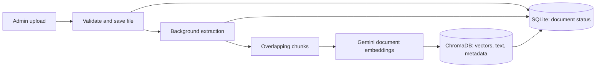
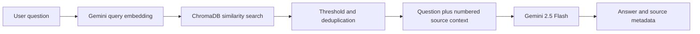

# Industrial Knowledge Copilot

A clean ITPM MVP for authenticated, role-based document search using retrieval-augmented generation (RAG). Admins upload and manage PDF, DOCX, XLSX, and TXT files; employees ask questions and receive Gemini-generated answers with document/page sources.

## Architecture

```text
React UI -> FastAPI + JWT -> SQLite (users, documents, query logs)
                         -> Extract/chunk -> Gemini embeddings -> ChromaDB
Question -> Gemini query embedding -> top chunks -> Gemini 2.5 Flash -> cited answer
```

Scanned-document OCR, knowledge graphs, IoT, and predictive maintenance are intentionally out of scope.

## RAG implementation

Retrieval-Augmented Generation (RAG) combines semantic document search with answer generation. This application retrieves uploaded document passages before calling Gemini; it does not train or fine-tune a model on the uploads. The pipeline is implemented directly with the Google Gen AI SDK and ChromaDB.

### 1. Document ingestion and indexing

1. An admin uploads a file through `POST /api/documents`. The endpoint checks the extension, rejects empty files and files over the configured size limit (25 MB by default), and calculates a SHA-256 fingerprint. Identical documents already ready or processing are rejected.
2. The original file is saved under a UUID filename. SQLite stores its name, uploader, hash, status, progress, and other metadata. The endpoint returns HTTP `202 Accepted` and schedules a FastAPI background task.
3. Text extraction depends on the format:

   | Format | Implementation | Source location |
   |---|---|---|
   | PDF | PyMuPDF reads selectable text page by page | Original one-based PDF page |
   | DOCX | python-docx reads paragraphs and table rows | No page number |
   | XLSX | pandas reads sheets and converts rows to CSV text | One-based sheet index stored in the `page` field; sheet name included in text |
   | TXT | UTF-8 text, replacing invalid characters | No page number |

4. `chunk_pages()` splits each extracted page/sheet independently into chunks of up to **1,000 characters**, with **200-character overlap** where possible. It prefers paragraph, sentence, or word boundaries. These are character counts, not token counts. Each chunk receives a sequential `chunk_id` and its source location.
5. `index_document()` embeds the chunks with `gemini-embedding-001` using `RETRIEVAL_DOCUMENT`. It stores vectors, chunk text, `document_id`, `document_name`, `page`, and `chunk_id` in the persistent ChromaDB collection `industrial_documents`. Missing page numbers are stored as `0` and converted back to `null` in answers.
6. SQLite progress advances through extraction, chunking, and indexing. Successful documents become `ready` with a chunk count; exceptions produce a `failed` status and an error message.



### 2. Retrieval and answer generation

An authenticated user sends a request to `POST /api/rag/query`:

```json
{
  "question": "What is the maintenance procedure for Pump P-101?",
  "top_k": 5
}
```

1. The question is embedded using the same embedding model with the `RETRIEVAL_QUERY` task type.
2. ChromaDB searches using **cosine distance**, requesting `min(top_k * 2, 20)` candidate passages. Lower distance means a closer semantic match.
3. Candidates with distance above `DISTANCE_THRESHOLD` (default `0.85`) are discarded. The implementation also removes passages with identical normalized first 100 characters, then retains up to `top_k` passages. This is a simple prefix-based deduplication heuristic, not a semantic reranker.
4. The backend labels passages `[Source 1]`, `[Source 2]`, etc., and includes their document names and available locations in the prompt context.
5. `gemini-2.5-flash` generates an answer at temperature `0.2`. The system instruction requests answers strictly grounded in the supplied passages, inline citations, and an explicit explanation when information is missing.
6. The response contains `answer` and `sources`. Each source includes its document ID, filename, page/location, an excerpt of up to 350 characters plus an ellipsis, and a similarity score. The score is rounded `1 - distance`, clipped to `[0, 1]`; it is **not a calibrated probability that the answer is correct**.
7. The API logs the question, user ID, and timestamp in SQLite. It does not persist the generated answer in the current query-log model.



If there are no matching passages, the service returns a no-evidence message without generating an answer. If the API key is absent, it returns a configuration message. Prompt instructions reduce unsupported answers but do not guarantee factual correctness.

### 3. Code map and storage

| File | Responsibility |
|---|---|
| [`backend/app/routers/documents.py`](backend/app/routers/documents.py) | Upload validation, duplicate checks, listing, re-indexing, deletion |
| [`backend/app/services/extraction.py`](backend/app/services/extraction.py) | Format-specific extraction and overlapping chunking |
| [`backend/app/services/indexing.py`](backend/app/services/indexing.py) | Background ingestion and SQLite progress/status updates |
| [`backend/app/services/rag.py`](backend/app/services/rag.py) | Gemini clients, embeddings, ChromaDB storage, retrieval, prompts, source handling |
| [`backend/app/routers/rag.py`](backend/app/routers/rag.py) | Authenticated query endpoint and query logging |
| [`backend/app/config.py`](backend/app/config.py) | Model names, storage paths, size limit, relevance threshold |

SQLite holds application records; ChromaDB holds searchable vectors and chunk text; the upload directory holds original files. `@lru_cache` reuses settings, the Gemini client, and the ChromaDB collection within each server process. It does not cache generated answers or question embeddings.

Admins can trigger `POST /api/documents/{document_id}/reindex` to process a stored file again. Indexing attempts to delete the document's previous vectors before embedding and upserting replacements. Document deletion attempts vector cleanup and removes the local file and SQLite record.

### 4. Configuration and current boundaries

| Setting | Default / purpose |
|---|---|
| `GEMINI_API_KEY` | Required for live embedding and generation |
| `GEMINI_CHAT_MODEL` | `gemini-2.5-flash` |
| `GEMINI_EMBEDDING_MODEL` | `gemini-embedding-001` |
| `CHROMA_PATH` | `./data/chroma` |
| `UPLOAD_PATH` | `./uploads` |
| `MAX_UPLOAD_SIZE_MB` | `25` |
| `DISTANCE_THRESHOLD` | `0.85`; lower values reject more candidates |

Run backend commands from `backend/` so the relative paths and `.env` lookup resolve as documented. Restart after changing settings. Changing the embedding model requires rebuilding a compatible vector index.

The current MVP has these implementation limits:

- Background tasks run in the API process; there is no durable queue or automatic recovery after a server restart.
- Embeddings are requested for all document chunks in one call; batching and explicit retry handling are not implemented.
- Citation processing extracts `[Source N]` numbers and filters returned sources when valid matches exist. It does not verify that a passage supports a claim, reject all invalid citations, or preserve explicit source IDs after filtering. Citation numbering can therefore need correction when only a subset is cited.
- Re-indexing is not atomic. Vector-deletion exceptions are currently suppressed, so failed cleanup may leave stale vectors.
- Retrieval searches the shared collection; document-level permissions, hybrid keyword search, and reranking are not implemented.

See [`PROJECT_EXPLANATION.md`](PROJECT_EXPLANATION.md) for the broader project walkthrough and technical vocabulary. The API tests include mocked RAG answers; passing them alone does not validate live Gemini retrieval quality. A live check requires a configured key, a document reaching `ready`, and a question whose answer and citations can be compared with that document.

## Run locally

Prerequisites: Python 3.11+, Node.js 20+, and a Gemini API key.

1. Copy `.env.example` to `.env` and set `GEMINI_API_KEY`, `JWT_SECRET`, and the initial admin password.
2. Start the API from `backend`:

   ```powershell
   python -m venv .venv
   .\.venv\Scripts\Activate.ps1
   pip install -r requirements.txt
   uvicorn app.main:app --reload
   ```

3. In a second terminal, start the web app from `frontend`:

   ```powershell
   npm install
   npm run dev
   ```

4. Open `http://localhost:5173` and sign in using `INITIAL_ADMIN_EMAIL` and `INITIAL_ADMIN_PASSWORD` from `.env`.

API docs are available at `http://localhost:8000/docs`; health is at `http://localhost:8000/health`.

## API summary

- `POST /api/auth/login`, `GET /api/auth/me`
- `POST/GET /api/users` (admin)
- `POST/GET /api/documents` (upload requires admin)
- `POST /api/documents/{document_id}/reindex`, `DELETE /api/documents/{document_id}` (admin)
- `POST /api/rag/query` (authenticated)
- `GET /api/dashboard` (authenticated)

## Production notes

This is a prototype. File-size checks and in-process background ingestion already exist. Before production, add migrations, durable ingestion workers, streaming upload limits, rate limits, malware scanning, secret management, HTTPS, refresh/revocation tokens, audit policy, backups, document-level authorization, and stronger citation/index consistency checks.
